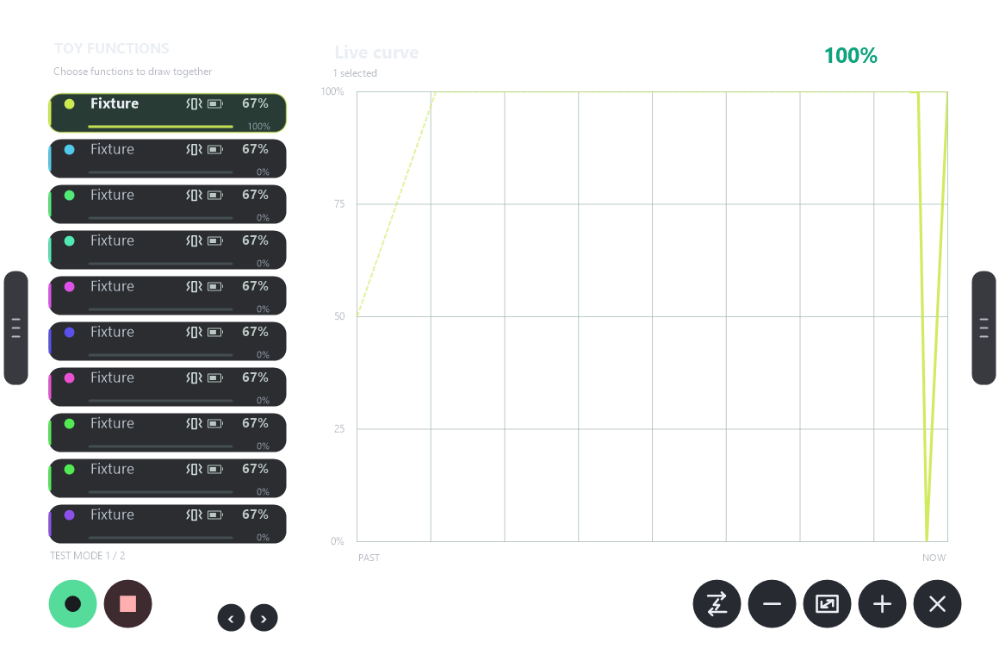
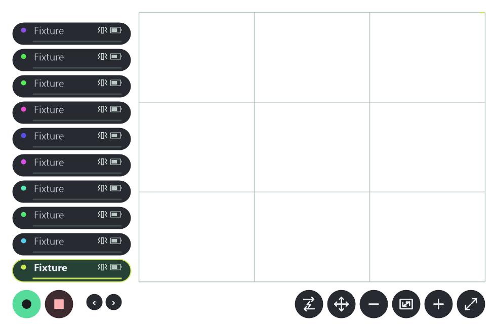

<p align="center">
  
</p>

<p align="center">
  <strong>Desktop and SteamVR controls, together in one Windows app.</strong><br>
  Wrist menu · Floating panel · Bluetooth toys · OpenShock · PiShock · OSC / SPS · Friends Connect
</p>

<p align="center">
  <a href="https://github.com/Szeb95/ShockWave/releases">Downloads</a> ·
  <a href="#getting-started">Getting started</a> ·
  <a href="#guides">Guides</a> ·
  <a href="https://github.com/Szeb95/ShockWave/issues">Report an issue</a> ·
  <a href="CONTRIBUTING.md">Contribute</a>
</p>

# ShockWave

ShockWave is a native Windows application for supported Bluetooth toys and OpenShock or PiShock devices. Draw and loop patterns on the desktop or with the built-in SteamVR wrist menu and floating panel. Pair with a friend running ShockWave, or use the separate VRChat OSC / SPS integrations.

**The SteamVR panel is included in the app.** It needs no Unity project, avatar installation or avatar upload.

**Current development preview: [0.8.1 — restored updates from older versions](https://github.com/Szeb95/ShockWave/releases/tag/v0.8.1).** Get the current complete Windows package from [Releases](https://github.com/Szeb95/ShockWave/releases/latest). See [verification and known limits](#verification-and-known-limits) before using hardware.

## What you can do

| Feature | How it works |
| --- | --- |
| **Bluetooth toy controls** | Discover supported Lovense toys, see individual functions and battery readings, and adjust Input, Sensitivity and Max %. |
| **Integrated SteamVR controls** | Open a compact wrist menu or a detailed floating panel. Use controller pointers, grip the side handles and resize with both hands. |
| **Draw and play patterns** | Select functions, draw curves, record and loop them through Toy control. Desktop and SteamVR share the same patterns and controls. |
| **Shocker control** | Use OpenShock or PiShock with individual limits, pause and cooldown. Shock requires two separate presses within three seconds. |
| **VRChat and SPS** | Shared automatic SPS controls, plug/socket discovery and optional manual body-map connections. |
| **Direct app connections** | Pair two ShockWave apps using a private code. Each receiver controls its own hardware and applies its own limits. |
| **Test mode** | Preview supported control paths without sending physical output. |

## A look inside


<details>
<summary>Shocker control, Connect and Update previews</summary>





</details>

These are software-test previews with simulated devices and empty connection codes. They illustrate the interface; they are not evidence of physical-device testing.

### Integrated SteamVR panel



1. Start SteamVR, then open ShockWave.
2. In **Settings → SteamVR panel**, choose the hand and whether to open as **Wrist** or **Panel**. Save settings to remember your choice.
3. Use the headset icon at the bottom left of **Toy control** or **Shocker control** to open the overlay. The icon beside it recenters the floating panel.
4. In Wrist mode, bring the other controller near the wrist icon, freshly hold grip and pull upward to unfold the menu. Select a toy function, then point at the grid and hold trigger to draw. Drawing continues outside the grid until you release.

Expand drops the larger panel. Touch either side handle and hold grip to move it while the other hand uses its pointer. Grip both handles and pull apart or together to resize; the return icon brings it back to the wrist. Pull the wrist's top bar back to its anchor to close the menu. Closing the wrist menu keeps active patterns and already submitted shocks running; **Stop** ends continuous toy activity and cancels pending shock confirmation.

Settings include whole-overlay transparency, saved wrist placement and optional automatic opening when SteamVR is available. [Read the SteamVR guide](docs/STEAMVR.md) for controls and current limits.

## Getting started

**Requirements:** Windows 10 version 1809 or newer, or Windows 11, on an x64 PC. The VR overlay requires SteamVR and tracked controllers; it runs independently of avatar content. Bluetooth control requires a compatible Windows Bluetooth adapter and supported toy. OpenShock and PiShock require their own hardware and account credentials. The separate VRChat OSC / SPS features require VRChat with OSC enabled.

To install:

1. Open [Releases](https://github.com/Szeb95/ShockWave/releases) and read that version's notes.
2. Download its Windows x64 package. For a portable ZIP, extract the **whole** archive and keep its folders together, then run `ShockWave.exe`.
3. Open **Settings** and enable **Test mode** before trying the controls. Fresh settings currently start with Test mode off.
4. Follow the guide for [Bluetooth toys](docs/lovense-remote/LOCAL-TOYS.md), [OpenShock](overlay/README.md) or [PiShock](docs/PISHOCK.md).
5. For VR, follow [SteamVR setup](docs/STEAMVR.md). For another ShockWave user, follow [Connect setup](docs/REMOTE.md). Keep connection codes private; connecting authorizes the paired person's supported controls within your limits.

**A visible toy or moving curve does not mean hardware output is enabled.** Test mode deliberately blocks vibration and other device commands. To use hardware, turn off **Settings → Debug → Test mode**, save settings and confirm Live mode, then select a connected function and start a fresh draw. Each owner's Sensitivity and Max % still apply.

The current Bluetooth backend bundles Intiface Engine as a hidden child process; no separate Intiface or Lovense Remote application is required. The optional legacy Lovense DLL has separate vendor terms and is excluded from the public source and current portable package.

The older avatar panel remains optional for existing setups: [Creator Companion listing](https://szeb95.github.io/ShockWave/) · [avatar installation guide](work/ToyControlEditor/README.md). It is separate from the integrated SteamVR panel. The Windows app does not install avatar content or save Unity scenes.

### Updates and saved settings

**Version 0.8.1 restores the direct update path from older releases.** Its SteamVR files use directories recognized by the original updater. Use **Check for updates → Update**; the earlier 0.8.0 package required a manual download because it used new root-level paths. Your settings and credentials stay in the same user-data folder.

**Update**, directly below Settings, shows the installed version, checks for published releases and links to the new version on GitHub. A newer compatible release adds **Update available** beside the Toy panel heading; clicking it opens Update. The **Update** button downloads and verifies the package, uses the existing normal-close confirmation, installs it and restarts ShockWave.

**Automatic update** defaults off. When enabled, new releases download in the background and install on your next normal app close, without reopening the app. Cancelling a close warning keeps ShockWave running. Install the first complete updater-enabled package manually; subsequent newer stable releases can be offered in the app. See [update setup and limits](docs/UPDATES.md).

Settings, device limits, mappings and encrypted credentials use the existing `%LOCALAPPDATA%\SzebsToys` data folder, independently of the program folder. Keep this folder private. See [the publication guide](docs/GITHUB-PUBLISHING.md) for packaging and release steps.

## Guides

| Topic | Guide |
| --- | --- |
| Windows interface, OpenShock and settings | [Windows app](overlay/README.md) |
| PiShock accounts and devices | [PiShock setup](docs/PISHOCK.md) |
| Bluetooth setup, compatibility and limits | [Local toys](docs/lovense-remote/LOCAL-TOYS.md) |
| Integrated wrist menu, floating panel and VR settings | [SteamVR](docs/STEAMVR.md) |
| Optional legacy avatar panel and Unity installation | [Avatar panel](work/ToyControlEditor/README.md) |
| SPS discovery and body mappings | [SPS](docs/lovense-remote/SPS.md) |
| Pairing two apps and connection limitations | [Connect](docs/REMOTE.md) |
| Standalone OSC bridge | [Bridge](bridge/README.md) |
| Current implementation and test evidence | [Workstream status](docs/lovense-remote/STATUS.md) |

## Verification and known limits

- Automated checks cover simulated devices, control limits, fresh-input rules, disconnect behavior and interface rendering. Physical Bluetooth response, stop timing and headset behavior still need model-specific verification.
- Six default SteamVR controller profiles are included. A live passive check verified pointer poses, triggers and grips on Oculus Touch; other headset/controller combinations still need physical testing.
- Direct app pairing has been exercised with two clients on one PC. Separate household/mobile networks still need testing. There is **no TURN relay fallback**; some networks cannot establish a direct connection.
- Stop cancels pending confirmation and continuous toy activity. A shocker command already accepted by its provider can continue for its bounded duration.
- Current Windows packages are unsigned. A clean-PC installation test remains pending.
- Use the relevant release notes and [detailed status](docs/lovense-remote/STATUS.md) to distinguish implemented features, simulated checks and physical tests.

## Build from source

Install the **.NET 8 SDK**, **Node.js 24.21.0** and **PowerShell 7** on Windows x64. From the project root:

```powershell
./overlay/build.ps1
```

The build restores locked Node dependencies when needed, verifies/downloads the pinned Bluetooth engine, publishes the app and checks its hidden worker without a physical device. The default output is `overlay/dist/shockwave/ShockWave.exe`.

This developer build requires the .NET 8 Desktop Runtime on the machine that runs it. Use `overlay/package-release.ps1` for a complete self-contained Windows ZIP with the updater ownership manifest. The [older installer pipeline](overlay/installer/README.md) still needs alignment with the current Bluetooth and remote package; it is not the update payload.

## Contributing

Bug reports, documentation improvements and focused pull requests are welcome. Start with [CONTRIBUTING.md](CONTRIBUTING.md), and use [SECURITY.md](SECURITY.md) for sensitive reports. Never upload credentials, invitation codes, personal configuration or private device identifiers.

## License and acknowledgements

ShockWave uses the [ShockWave Source-Available Contribution License 1.0](LICENSE). It permits inspecting/building ShockWave and making changes to contribute fixes back to the official project. Publishing independent modified releases or reusing its code in unrelated projects requires separate permission. GitHub's own public-repository viewing/forking permissions and third-party licenses remain applicable.

ShockWave is **source available** under these contribution-only terms. Read [the full license](LICENSE) before using the source or contributing changes.

Third-party components retain their own licenses. See [THIRD-PARTY.md](THIRD-PARTY.md), [rendering notices](work/ShaderPanelTest/THIRD-PARTY.txt) and [Bluetooth engine notices](overlay/native/buttplug/VERSION.md). ShockWave is an independent project; product names identify integrations and do not imply endorsement.
